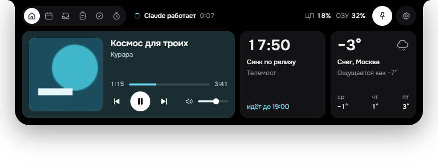

# Остров

Dynamic Island для Windows: чёрный «остров» вверху экрана, который раскрывается при наведении.



## Что умеет

- **Музыка** — что играет (Яндекс Музыка и любой плеер через Windows SMTC), обложка, пауза и переключение, громкость.
- **Календарь** — события Яндекс Календаря по iCal-ссылке и кнопка «Подключиться» для Телемоста и других созвонов.
- **Агенты** — статус работы Claude, Cursor и Codex.
- **Буфер обмена** — история ссылок, текста и скриншотов с фильтром и закреплением. История зашифрована (DPAPI).
- **Полка файлов** — перетащите файлы на остров, а потом вытащите их куда нужно.
- **Задачи, таймер и погода** — погода от MET Norway, город настраивается.
- **Сообщения** — уведомления Яндекс Мессенджера.
- **Без помех** — прячется в полноэкранных приложениях. Над вкладками и текстом сворачивается в тонкую полоску, а над пустым местом остаётся обычным. Можно выбрать монитор.
- **Клавиатура** — `Ctrl+Alt+Space` открывает остров, `←/→` и `1–7` переключают разделы, `Esc` закрывает.

## Устройство

- `src-tauri/` — Tauri 2 на Rust: окно, трей, горячая клавиша, буфер обмена, полка, хранилище, наблюдение за агентами.
- `ui/` — интерфейс (HTML/CSS/JS). `ui/bridge.js` связывает его с Rust.
- `media.ps1` — музыка, громкость и полноэкранный режим через PowerShell.
- `notify.ps1` — уведомления Windows через PowerShell.
- `main.js`, `preload.js`, `agents.js`, `calendar.js` — прежняя версия на Electron.

## Сборка

Нужны Node.js и Rust.

```bash
npm install
npm run dist:tauri
```

Установщик появится в `dist/Ostrov-Setup-<версия>.exe` (около 2 МБ).
